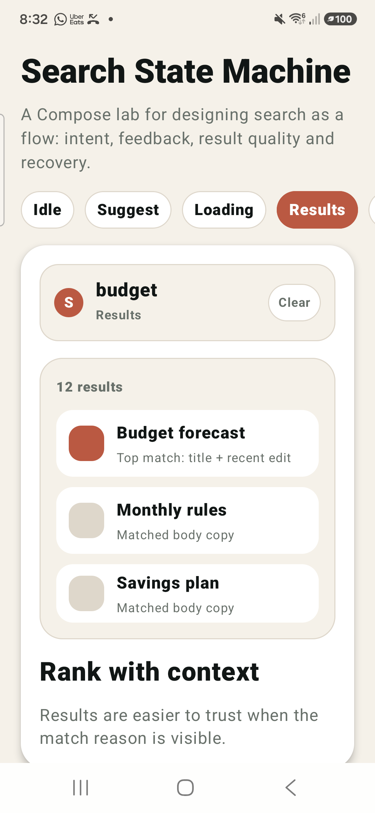

# Search State Machine

Mini-projet Android/KMP pour explorer les etats d'une experience de recherche dans une UI Compose.

Le but n'est pas de livrer une app complete, mais de montrer une recherche comme une state machine produit :

- idle avec recherches recentes ;
- suggestions pendant la saisie ;
- loading non bloquant ;
- resultats avec raisons de ranking ;
- empty state avec recovery ;
- erreur avec retry contextualise.

## Pourquoi ce mini-projet ?

La recherche est souvent traitee comme un champ + une liste. En pratique, c'est une succession d'etats qui doivent garder l'intention de l'utilisateur vivante :

- que montre-t-on avant la premiere query ?
- faut-il afficher un loader global ou local ?
- comment expliquer pourquoi un resultat est pertinent ?
- que fait-on quand il n'y a rien ?
- comment relancer sans perdre la query ?

Le lab permet de comparer les micro-decisions qui rendent une recherche plus claire, plus rassurante et plus efficace.

## Stack

- Kotlin Multiplatform
- Compose Multiplatform
- Material 3
- Android target pret a lancer

## Screenshots

<p align="center">
  
</p>

## Idee de post LinkedIn

> Une recherche produit n'est pas juste un TextField.
>
> Dans ce mini-projet Compose/KMP, je modele la recherche comme une state machine : idle, suggestions, loading, resultats, empty et error.
>
> Ce qui change tout : chaque etat doit aider l'utilisateur a garder son intention.

## Run

```bash
./gradlew :composeApp:assembleDebug
```
